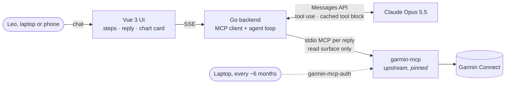

<div align="center">

# 🏃 RunCoach AI

**A chat over your own Garmin data. Ask in plain words; the coach reads your activities, sleep, HRV, stress and training load through MCP and answers in grounded prose, with one chart when a pattern is the point.**

_by [Leo Magsino Jr](https://github.com/lmagsino)_


</div>

---

## The idea

A Garmin watch records far more than the Garmin app lets you ask about. RunCoach AI connects to the upstream [`Taxuspt/garmin_mcp`](https://github.com/Taxuspt/garmin_mcp) server over the **Model Context Protocol**, hands Claude about eighty read-only tools, and lets you ask:

> _"Does my sleep actually affect my pace? Show me the pattern."_ · _"Am I overtraining right now?"_ · _"How did my last three training blocks compare?"_ · _"I have a half marathon in 10 weeks. Am I on track, given how recovered I've been?"_ · _"Why has my body battery been so low this week?"_

Every reply is grounded in what the tools returned. No generic training advice, no dashboards. **The chat is the product.**

It is built for one runner (me) first, with every table and interface shaped so a second runner is additive later. The decisions are recorded in [`docs/adr/`](docs/adr/), the terms in [`CONTEXT.md`](CONTEXT.md), the plan in [`tasks/plan.md`](tasks/plan.md).

## Architecture

The Go backend is a pure **MCP client**. For each reply it spawns the upstream Garmin server as a subprocess, filters its tool list down to the read-only surface, and runs Claude's tool loop over it. The Vue 3 frontend streams the steps and the reply.



Three things are deliberate and recorded as ADRs:

- **The hosted server never signs in to Garmin** ([ADR 0003](docs/adr/0003-hosted-server-never-signs-in-to-garmin.md)). The sign-in (email, password, MFA) happens once on the laptop with upstream's `garmin-mcp-auth`; the server only uses the resulting tokens, and the spawned process gets an allowlisted environment so it cannot sign in even if asked.
- **The read surface is a deny pattern in Go, not an allowlist** ([ADR 0004](docs/adr/0004-upstream-garmin-mcp-unmodified-read-surface-filtered-in-go.md)). Upstream has 155 tools; writes, deletes, uploads and the groups a coach has no use for are denied by name shape, applied to the live tool list. 77 tools remain at the pinned commit.
- **Charts are a tool the model calls and the backend validates** ([ADR 0005](docs/adr/0005-charts-are-a-virtual-tool-validated-by-the-backend.md)), drawn by hand in SVG. Phase 6.

## Tech stack

| Layer | Choice |
|---|---|
| Backend | **Go 1.26**, stdlib `net/http`, `pgx/v5`, `golang-migrate` |
| Agent | **Claude Opus 5.5** via the Anthropic Go SDK: tool loop, explicit effort, prompt caching on the system prompt and tool block |
| Protocol | **MCP** via the official `modelcontextprotocol/go-sdk` |
| Garmin | **`Taxuspt/garmin_mcp`** installed from git at a pinned commit, spawned per reply |
| Frontend | **Vue 3 + Vite + Tailwind v4**, the "Field Notes" design in [`DESIGN.md`](DESIGN.md) |
| Database | **Postgres**, optional until chats are persisted (Phase 7) |
| Hosting | **Free tiers only** (Phase 8): one Render free web service plus Neon free Postgres |

## Repository layout

```
run-coach-ai/
├── docs/adr/                          # the decisions, 0001–0009
├── CONTEXT.md                         # the glossary
├── tasks/plan.md, tasks/todo.md       # the plan, phases 5–8
├── DESIGN.md, design/                 # "Field Notes" UI direction
├── deploy/garmin-mcp/                 # upstream garmin_mcp image + one-off auth; tools.txt
├── backend/                           # Go API
│   ├── cmd/server, cmd/migrate
│   └── internal/
│       ├── agent/        # Claude tool loop over namespaced MCP sources
│       ├── mcpclient/    # spawns garmin-mcp; ReadOnly() deny pattern; allowlisted child env
│       ├── api/          # /healthz, /sources, /chat, /chat/stream (SSE)
│       └── mockchat/     # canned scenarios for the five questions
└── frontend/                          # Vue 3 app
```

## Getting started

**Prerequisites:** Go 1.26+, Node 22+, an [Anthropic API key](https://console.anthropic.com). Docker only for the Garmin server.

Run the UI against canned answers first, with nothing else set up:

```bash
cd backend && RUNCOACH_MOCK=1 go run ./cmd/server     # API on :8080, no credentials, no database
cd frontend && npm install && npm run dev               # UI on :5173
```

Then connect your own Garmin:

```bash
cd deploy/garmin-mcp
docker compose build                                    # garmin_mcp at the pinned commit
docker compose --profile auth run --rm garmin-mcp-auth  # interactive: email, password, MFA code, once

cd ../../backend
cp .env.example .env                                    # ANTHROPIC_API_KEY, uncomment GARMIN_MCP_COMMAND
go run ./cmd/server
curl -s localhost:8080/chat -d '{"question":"How did I sleep this week?"}'
```

The auth step writes OAuth tokens (good for about six months) into a named volume the container reuses; no credential is needed per request. When they expire, run it again.

> `garmin_mcp` drives Garmin Connect's private endpoints with a personal login. There is no public API behind it, so it can break when Garmin changes them; the coach then says "Garmin unavailable" rather than guessing.

### Testing: no credentials, no Docker, no network

```bash
cd backend && go test ./...
cd frontend && npm test
```

The agent's full tool loop runs against **in-process stub MCP servers** and a **scripted stand-in for the Messages API**: tool namespacing and routing, the read-surface filter, the cache and effort markers on every request, and grounding scenarios on fabricated sleep and pace datasets. One test asks the *real* model to choose its own tools over that fake data, and is skipped unless you opt in:

```bash
RUNCOACH_LIVE_MODEL_TESTS=1 go test ./internal/agent/ -run LiveModel -v   # costs Anthropic tokens
```

## Status

- [x] Phases 1–4: design, Go backend, Garmin wiring, Vue chat UI, all against mocks
- [ ] **Phase 5, Garmin core**: Strava removed, database optional, pin bumped, read surface filtered in Go, Garmin-only prompt on Opus 5.5
- [ ] Phase 6, charts
- [ ] Phase 7, shell: owner login, token paste, saved chats, sidebar
- [ ] Phase 8, deploy on free tiers and test live

Nothing has run against a live Garmin account yet. Phase 8 is where that happens, on purpose: the build phases need no account, and everything gets tested together once.

## Design

The chat UI follows a **"Field Notes"** direction: quiet, one accent colour, generous whitespace, replies as flowing prose rather than chat bubbles. Full reference in [`DESIGN.md`](DESIGN.md); mockups in the design artifact linked from the spec.

| Token | Hex | Role |
|---|---|---|
| `paper` | `#EDECE6` | App background |
| `ink` | `#1C201C` | Primary text |
| `accent` | `#2E5D4E` | Deep pine green, the one accent |

---

<div align="center">

**Built by [Leo Magsino Jr](https://github.com/lmagsino)** · Personal project · 2026 · Not affiliated with Garmin

</div>
