<div align="center">

# 🏃 RunCoach AI

**Ask your Garmin anything.**

A chat over your own Garmin data. Ask in plain words; the coach reads your runs, sleep, HRV, stress and training load through the Model Context Protocol and answers in grounded prose, with one chart when a pattern is the point.


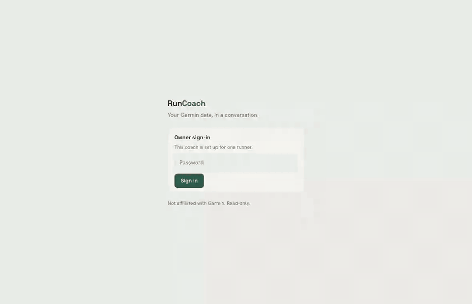

<sub>A real question against my own Garmin account, recorded as it happened: 18 seconds, three Garmin tools, one chart, about five cents.</sub>

</div>

---

## The idea

A Garmin watch records far more than the Garmin app lets you ask about. It knows every run, every night's sleep, your HRV, stress, body battery and training load, but it only shows them one screen at a time, and it never answers a question like *"does my sleep actually affect my pace?"*

RunCoach does. It hands Claude about eighty read-only Garmin tools and lets you ask:

> _"Does my sleep actually affect my pace? Show me the pattern."_
> _"Am I overtraining right now?"_
> _"How did my last three training blocks compare?"_
> _"I have a half marathon in 10 weeks. Am I on track, given how recovered I've been?"_
> _"Why has my body battery been so low this week?"_

Every reply is grounded in what the tools returned, cites the numbers and dates, and says plainly when the data is not there. Replies are short, the conclusion comes first, and when a conclusion rests on a series of values the chart carries them, as the proof. Off-topic questions are declined before they cost anything. No generic training advice, no dashboards. **The chat is the product.**

It is built for one runner first (me), with every table and interface shaped so a second runner is additive later.

## How it works

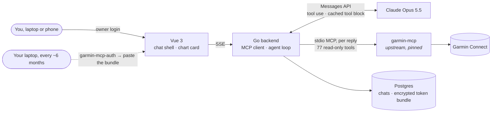

The Go backend is a pure MCP client. A small model screens each question first: off-topic ones are declined on the spot, and on-topic ones get a concrete scope (which metrics, which dates). Then the backend spawns the upstream [`Taxuspt/garmin_mcp`](https://github.com/Taxuspt/garmin_mcp) server, filters its tool list down to the reads, and runs Claude's tool loop over exactly that scope. The frontend streams the steps as they happen, then the chart and the reply.

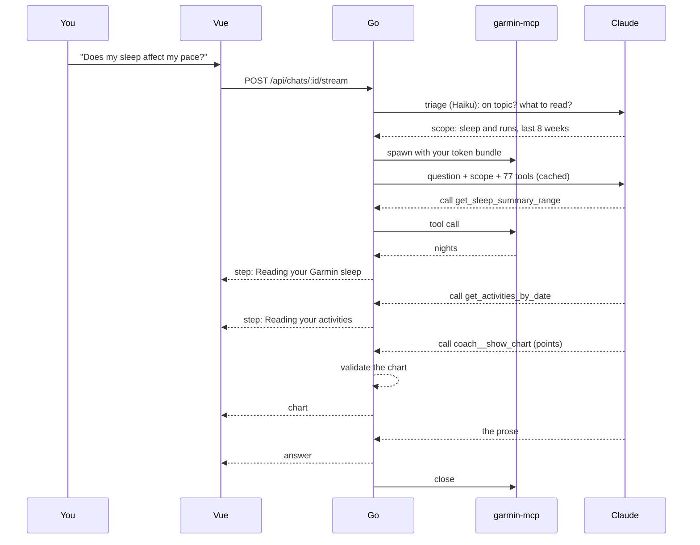

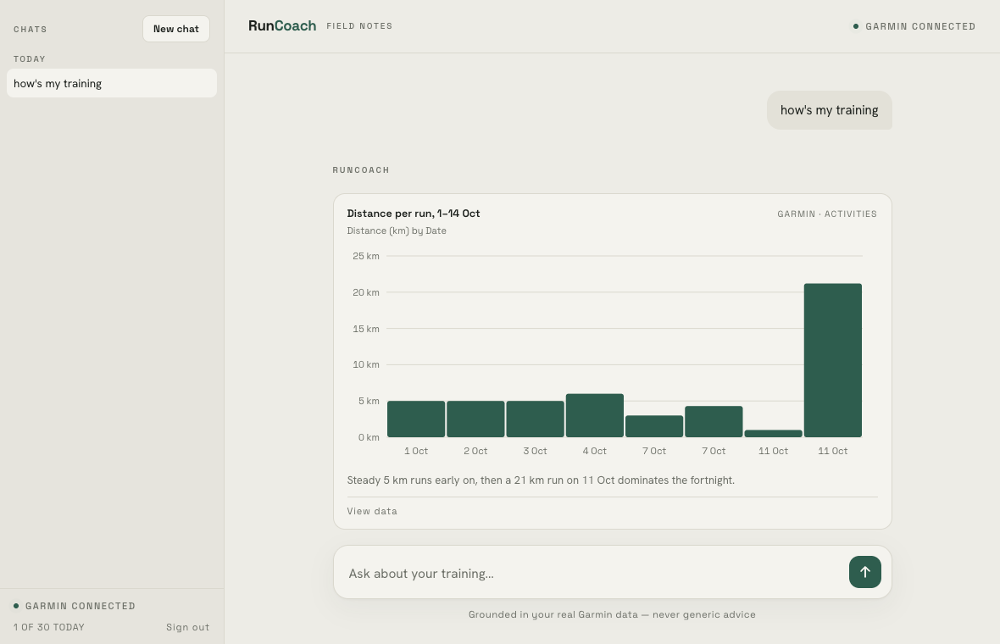

<sub>The finished reply. The chart is drawn from the activities the coach read, the caption names the pattern, and "View data" shows the points.</sub>

### The chart is the proof

The coach has a `show_chart` tool next to the Garmin ones. After reading the data and before writing, it reshapes the values its conclusion rests on into points and calls it; the backend validates the spec (line, bar or scatter, 5 to 120 points, one axis, never a dual axis) and the browser draws it by hand in SVG. The prose then names the pattern and the one or two numbers that matter. A single number gets a pull quote instead. Every chart has a "View data" table.

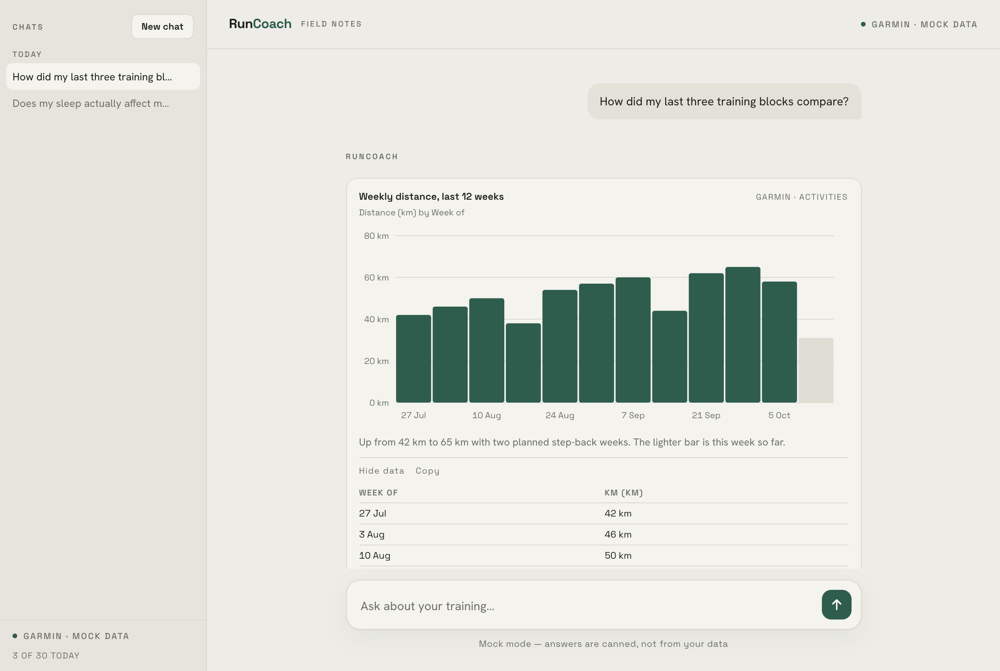

<sub>Mock mode, labelled as such: canned answers for the five example questions, so the UI can be built and demoed with no account at all.</sub>

### On the phone

<p>
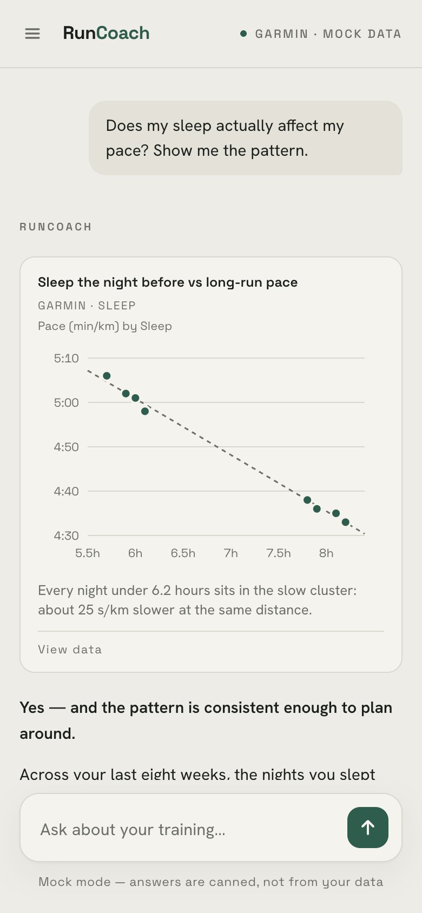
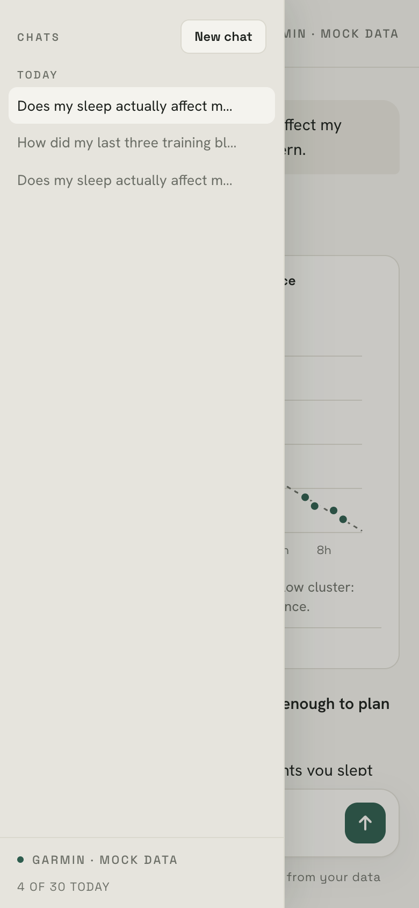
</p>

### Signing in, and connecting Garmin

Every runner signs in with an email and a password, remembered for 30 days. Garmin is connected with a token bundle created once on your own laptop by upstream's `garmin-mcp-auth`; the server imports it on start (or from a paste, on a hosted copy), checks it with one profile read, stores it encrypted, and hands it to each spawned `garmin-mcp`. **The hosted server never signs in to Garmin itself.**

<p>
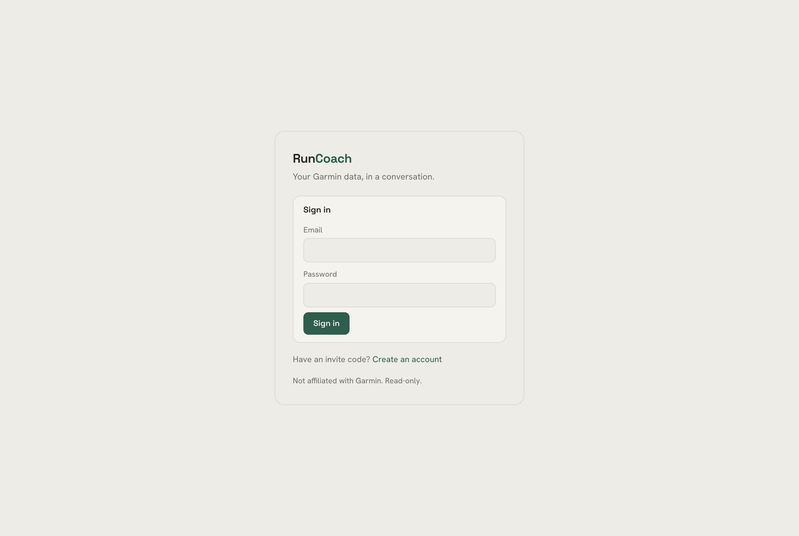
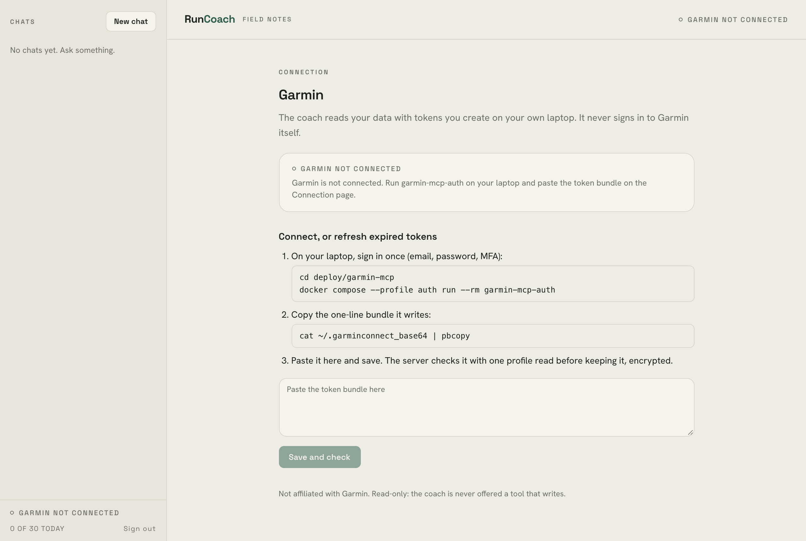
</p>

## Decisions worth knowing

Each one is an ADR in [`docs/adr/`](docs/adr/); the terms are in [`CONTEXT.md`](CONTEXT.md).

| | Decision | Why |
|---|---|---|
| [0001](docs/adr/0001-garmin-is-the-only-source.md) | Garmin is the only source | It already holds everything the training log had, plus recovery |
| [0003](docs/adr/0003-hosted-server-never-signs-in-to-garmin.md) | The server never signs in to Garmin | Garmin throttles server sign-ins per IP; the spawned process gets an allowlisted environment so it cannot sign in even if asked |
| [0004](docs/adr/0004-upstream-garmin-mcp-unmodified-read-surface-filtered-in-go.md) | Upstream unmodified; the read surface is a deny pattern in Go | Upstream's own allowlist ignores unknown names silently; a pattern denies a new write tool by shape |
| [0005](docs/adr/0005-charts-are-a-virtual-tool-validated-by-the-backend.md) | Charts are a tool the model calls and the backend validates | The model reshapes, the backend checks, the browser draws |
| [0006](docs/adr/0006-opus-5-5-with-explicit-effort-and-prompt-caching.md) | Opus 5.5 with explicit effort and prompt caching | Cache reads cost the same as Sonnet; the premium lands only on uncached tokens |
| [0007](docs/adr/0007-one-free-render-service-serves-api-and-ui-from-one-origin.md) | One free Render service serves API and UI from one origin, Neon for Postgres | Free only; one cookie, no CORS, tokens encrypted in the database because there is no disk |

## Tech stack

| Layer | Choice |
|---|---|
| Backend | **Go 1.26**, stdlib `net/http`, `pgx/v5`, `golang-migrate`; one `store` package is the only data access |
| Agent | **Claude** via the Anthropic Go SDK: Haiku 5.5 screens and scopes, Sonnet or Opus 5.5 answers; tool loop, explicit effort, prompt caching on the system prompt and tool block |
| Protocol | **MCP** via the official `modelcontextprotocol/go-sdk` |
| Garmin | **`Taxuspt/garmin_mcp`** at a pinned commit, spawned per reply; 77 of its 155 tools exposed |
| Frontend | **Vue 3 + Vite + Tailwind v4**, the "Field Notes" design in [`DESIGN.md`](DESIGN.md), hand-rolled SVG charts |
| Database | **Postgres**, optional locally; chats and the encrypted token bundle |
| Hosting | **Free tiers**: one Render web service from the `Dockerfile`, Neon Postgres |

## Run it

**Prerequisites:** Go 1.26+, Node 22+. Docker only for the Garmin server. Postgres only once you want chats to survive a restart.

Try the UI against canned answers first, with nothing else set up:

```bash
RUNCOACH_MOCK=1 bin/dev     # API on :8787 and UI on http://localhost:5173; no login, credentials or database
```

`bin/dev` runs the API (`go run`) and the UI (Vite) together in the foreground, like a Rails `bin/dev`; Ctrl-C stops both. Both listen on this computer only.

Then for real, locally:

```bash
cd backend
cp .env.example .env                                    # ANTHROPIC_API_KEY, GARMIN_MCP_COMMAND, GARMIN_EMAIL/PASSWORD, then:
go run ./cmd/token-key                                  #   RUNCOACH_TOKEN_KEY
                                                        #   RUNCOACH_OWNER_EMAIL and RUNCOACH_OWNER_PASSWORD

cd ../deploy/garmin-mcp
docker compose build garmin-mcp                         # garmin_mcp at the pinned commit
./auth.sh                                               # sign in once (MFA); leaves the token bundle for the server

cd ../.. && bin/dev                                     # imports the bundle on start: "garmin: connected"
```

Open the UI, sign in, and ask. When the bundle expires, about six months later, the chip says so; run `auth.sh` again and restart.

> **On a managed work laptop**, run it exactly like this: `bin/dev` from the repository. Don't build a server binary and start it from a script, or launch anything from `/tmp`; endpoint security tools treat a fresh unsigned program started from a temp folder as malware, and CrowdStrike did exactly that during this project. The Dockerfile is for the host (Render builds it), not for running locally. Values in `.env` win over the shell's environment, so a key exported for another tool cannot leak in.

### What a question costs

Pricing is per token, so every question has a price. Measured on the question above, on Sonnet 5.5: about 8k input tokens, 59k read from cache at a tenth of the price, 1k output, roughly five cents. The triage step on Haiku is a fraction of that, the daily cap is 30 questions, and `ANTHROPIC_MODEL` switches between Haiku, Sonnet and Opus with no other change.

## Guide: inviting other runners

RunCoach takes other runners by invite. Each runner has their own account, chats and Garmin connection; their Garmin password never reaches the server; and every runner's questions are billed to the owner's API key, so caps keep the bill bounded ([ADR 0010](docs/adr/0010-other-runners-by-invite-with-a-pasted-bundle.md)). Everything below was run against a real server, a Postgres database and a real Garmin account before it was written down ([test report](docs/live/phase-9.md)).

### For the owner: open sign-up

1. Pick an invite code and set it on the server: `RUNCOACH_INVITE_CODE=…` in `backend/.env` locally, or in Render's dashboard when hosted. Restart. Without a code, sign-up is closed and the sign-in page shows no "Create an account" link.
2. Share the site's address and the code with the runner.
3. Optionally set the caps: `RUNCOACH_MEMBER_CAP` (questions a day for each new member, default 10) and `RUNCOACH_GLOBAL_DAILY_CAP` (all runners together, default 100). The owner keeps 30.

### For a runner: get started

**1. Create an account** with your name, email, a password of 10 characters or more, and the invite code. You land on your account page.

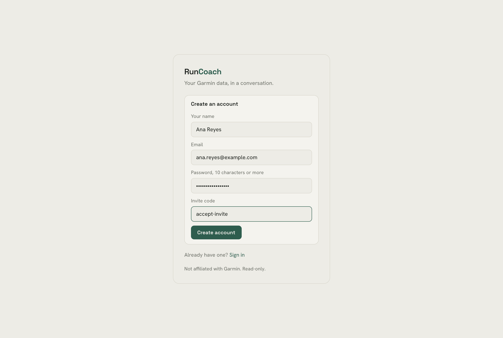

**2. Connect Garmin.** On the account page, enter your Garmin Connect email and password and press "Connect Garmin". If Garmin sends you a code, type it in within a few minutes. The server signs in once, keeps only the access Garmin grants (encrypted), and never stores the password ([ADR 0011](docs/adr/0011-runners-may-sign-in-to-garmin-through-the-server.md)). The chip turns to "Garmin connected", good for about six months.

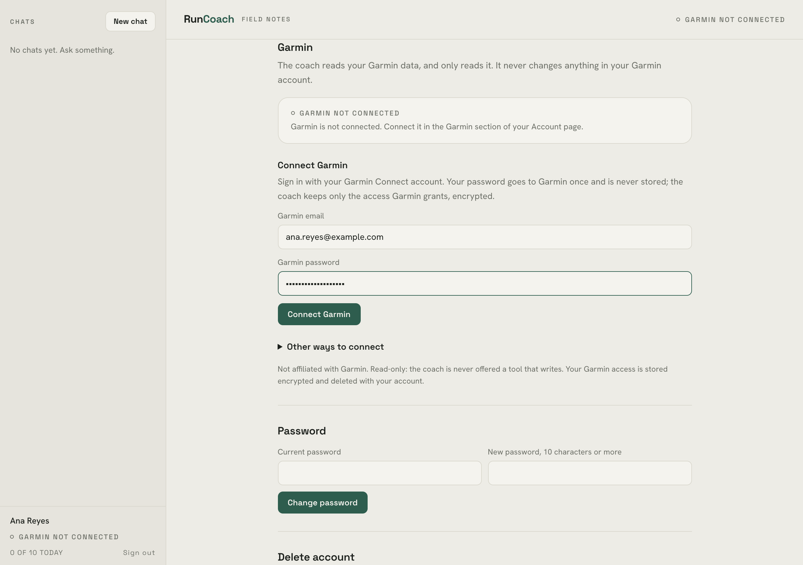

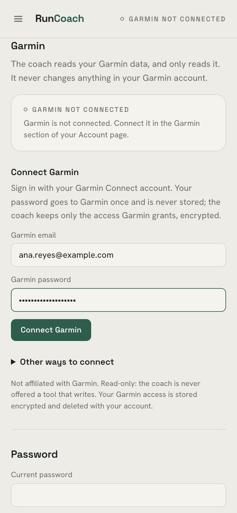

**If Garmin refuses the sign-in.** Garmin sometimes turns away sign-ins that come from a server. The page then says so and opens "Other ways to connect": make a token bundle on your own computer, where Garmin asks for your email, password and code, and paste the one line it prints. Nothing to clone.

```bash
# with uv (https://docs.astral.sh/uv)
uvx --from "garmin-mcp @ git+https://github.com/Taxuspt/garmin_mcp@43b0c5b375fc1c7bd6bdbead69968dfabddec265" garmin-mcp-auth
cat ~/.garminconnect_base64 | pbcopy        # Windows: | clip

# or with Docker, using the image this repo publishes
docker run -it --rm -v "$PWD:/out" -e GARMINTOKENS_BASE64=/out/garmin_tokens.b64 \
  --entrypoint garmin-mcp-auth ghcr.io/lmagsino/garmin-mcp:43b0c5b
cat garmin_tokens.b64 | pbcopy && rm garmin_tokens.b64
```

Paste the line and press "Save and check": the server reads your Garmin profile once to prove it works and stores it encrypted.

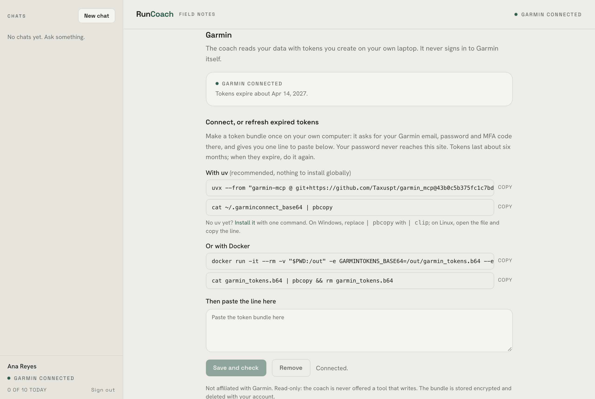

**4. Ask.** Replies come from your own Garmin data only, with the numbers and dates they rest on. Your chats are yours: another runner gets "not found" even with the link.

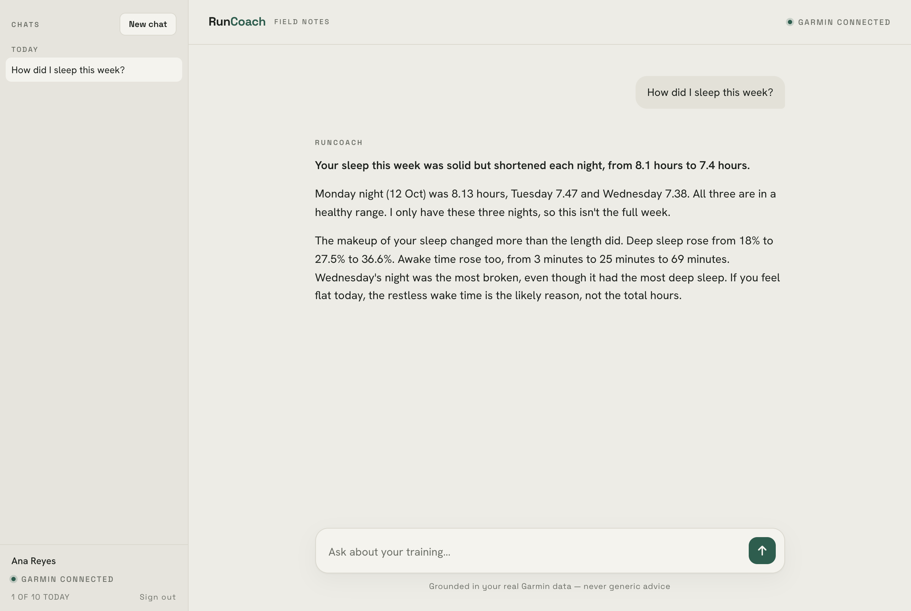

**On the phone** everything works the same; the chat list opens from the menu.

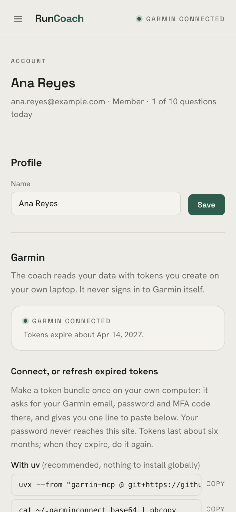

### Limits and account settings

- **Daily questions.** When a runner has used their questions for the day, the composer closes and says so before anything is sent; it reopens at midnight UTC. When the whole coach reaches the global cap, everyone sees the same.

  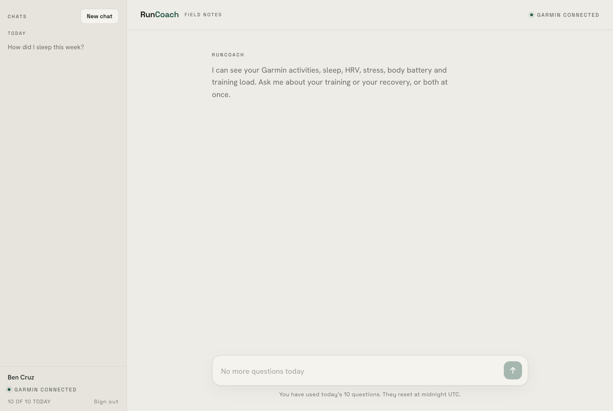

- **Name and password** change on the account page. Changing the password signs the runner out on every other device.
- **Expired Garmin connection.** After about six months the chip says so; connect again (step 2).
- **Deleting an account** takes the runner's chats, usage and Garmin bundle with it, at once and for good. It asks for the password and a second confirmation. The owner's account cannot be deleted.

  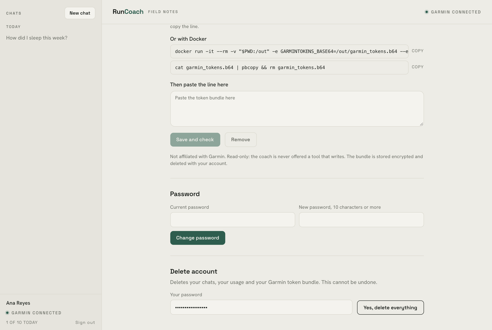

- **A forgotten password.** There is no reset email. The owner sets a new one from the server's terminal, which also signs that runner out everywhere:

  ```bash
  echo -n 'a new password' | go run ./cmd/set-password ana@example.com
  ```

## Deploy, free

`Dockerfile` builds one image (the Vue build embedded in the Go binary, `garmin-mcp` installed beside it) and [`render.yaml`](render.yaml) describes one Render free web service with `/healthz` as its health check. Pair it with a Neon free Postgres and enter four values when Render asks: `DATABASE_URL`, `ANTHROPIC_API_KEY`, `RUNCOACH_OWNER_EMAIL` and `RUNCOACH_OWNER_PASSWORD`. Render generates `RUNCOACH_TOKEN_KEY` itself. Optionally add `RUNCOACH_GARMIN_BUNDLE` (the line `bundle.sh` prints) so your Garmin is connected from the first start. Migrations run on start. The free service sleeps when idle and takes about a minute to wake; the login page says so while it waits.

## Tests, with no credentials and no network

```bash
cd backend && go test ./...
cd frontend && npm test
cd frontend && npm run e2e      # browser walkthrough against a mock-mode backend
```

The agent's full tool loop runs against in-process stub MCP servers and a scripted stand-in for the Messages API: tool namespacing and routing, the read-surface filter, the cache and effort markers on every request, chart validation, and grounding scenarios on fabricated sleep and pace datasets. The store suite runs on an in-memory store always and on Postgres when `RUNCOACH_TEST_DATABASE_URL` is set. One opt-in test lets the real model choose its tools over the fake data:

```bash
RUNCOACH_LIVE_MODEL_TESTS=1 go test ./internal/agent/ -run LiveModel -v   # costs Anthropic tokens
```

## Status

- [x] Phases 1–4: design, Go backend, Garmin wiring, Vue chat UI, all against mocks
- [x] Phase 5, Garmin core: read surface filtered in Go, Garmin-only prompt with a category map
- [x] Phase 6, charts: one validated chart card per reply
- [x] Phase 7, shell: owner login, token paste, saved chats, sidebar and phone drawer, one origin
- [x] Live on my own account: the sign-in, the bundle import, triage, the first real replies with charts
- [x] Phase 9, accounts: sign-up by invite, email sign-in, account page, Garmin per runner, member and global caps
- [ ] **Phase 8, deploy on free tiers**: image and blueprint written; the Render + Neon setup, the full five-question pass and Playwright in CI remain

The plan and its checklist are in [`tasks/`](tasks/).

> `garmin_mcp` drives Garmin Connect's private endpoints with a personal login. There is no public API behind it, so it can break when Garmin changes them; the coach then says "Garmin unavailable" rather than guessing.

## Design

The UI follows a **"Field Notes"** direction: quiet, one accent colour, generous whitespace, replies as flowing prose rather than chat bubbles. Reference in [`DESIGN.md`](DESIGN.md).

| Token | Hex | Role |
|---|---|---|
| `paper` | `#EDECE6` | App background |
| `ink` | `#1C201C` | Primary text |
| `accent` | `#2E5D4E` | Deep pine green, the one accent |

---

<div align="center">

**Built by [Leo Magsino Jr](https://github.com/lmagsino)** · Personal project · 2026 · Not affiliated with Garmin

</div>
